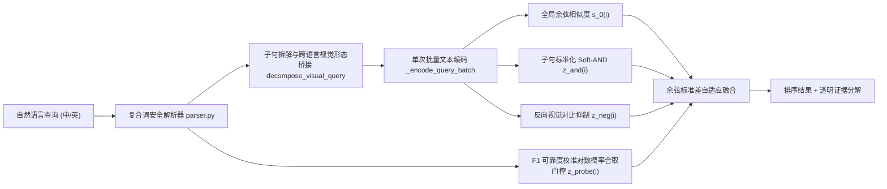

# 纯图像（Image-Only）多条件组合文物检索、双语属性对比 LoRA 与 10,200 张扩库实验报告

> [!IMPORTANT]
> **评测边界与学术诚信声明**：
> 1. 所有方法（[`subquery_and`](../src/curio/retrieve/compositional.py) 与 [`compositional`](../src/curio/retrieve/compositional.py)）严格运行于 **纯图像图库（Image-Only Gallery）** 模式：在线排序仅使用输入查询、图像嵌入与图像线性分类探针，绝不读取馆藏标题、描述、标签或 BM25，当图像索引缺失时绝不回退到元数据检索（由 [`tests/test_compositional.py`](../tests/test_compositional.py) 篡改全部馆藏文本验证分数与排序 100% 不变）。
> 2. [`eval/visual_dev`](../eval/visual_dev/queries.jsonl) 与 [`eval/visual_test`](../eval/visual_test/queries.jsonl) 的相关性标注源自仓库披露的盲图像 AI 视觉审计（`ai_visual_audit`），并非独立人工金标准；全部超参数仅在 `visual_dev` 上确定并冻结于 `artifacts/evaluation/compositional_v3/selection_manifest.json`，随后对 `visual_test` 仅执行一次评测。

---

## 1. 问题诊断：为什么原仓库 v2 的视觉属性重排未能生效？

在原仓库生产配置 `artifacts/visual_selection.json` 中，虽然训练了 5 类视觉探针，但开发集最优探针权重最终被迫选为 `weight = 0.0`（退化为纯全局单向量检索）。通过在 `visual_dev` 上逐题诊断，定位到三个根本原因：

1. **单字子串误触发导致错误槽位注入**（[`src/curio/query/parser.py`](../src/curio/query/parser.py)）：
   - 中文单字词缺少复合词与语法边界保护：如 `"像尖刃"` / `"像喇叭一样"` 误触发 `object_type=figure`（人像），`"盘旋雕刻"` 误触发 `object_type=plate`（盘），`"树木"` 误触发 `material=wood`（木质），`"穿绿袍的人物"` 误触发独立服饰 `garment`，英文 `"covered with"` 误触发 `lid`。这直接导致中文 `visual_dev` 在开启探针后从 `0.9050` 跌至 `0.8841`。
2. **全局单向量“词袋平均”效应（对应课程多属性检索痛点）**：
   - 双塔编码器将整句压缩为单一向量，某件“器型和主色极显著但缺少局部柄/耳/人物纹饰”的部分匹配藏品，余弦分往往高于同时满足全部 3–4 个条件的完整匹配藏品。
3. **RRF 秩变换抹平余弦间隔 + 算术平均纵容偏科**：
   - 原 `61 / (60 + rank)` 变换丢弃了真实的余弦置信度差值（Margin），且对各探针概率取算术平均 `mean(P)` 无法惩罚缺失属性，弱探针（如 `motifs`，`dev_macro_f1 = 0.545`）与强探针（`object_type`，`dev_macro_f1 = 0.858`）等权混用进一步引入噪声。

---

## 2. 算法设计：多条件子句软合取与可靠度校准探针门控

核心实现位于 [`src/curio/retrieve/compositional.py`](../src/curio/retrieve/compositional.py) 与 [`src/curio/retrieve/engine.py`](../src/curio/retrieve/engine.py)：



### 2.1 子句拆解与跨语言视觉形态桥接（`subquery_and`）
- **主体锚定子句拆解**（`decompose_visual_query`）：将多条件长句拆分为全局提示 $q_0$、若干带主体名词锚定的局部条件子句 $\{q_1, \dots, q_m\}$（如 `a vase with tall curved handle`）以及排除对比短语 $\{q^-_1, \dots, q^-_r\}$（支持 `without / rather than / 不要 / 而不是`）。
- **跨语言可见形态桥接**（`ZH_VISUAL_GLOSSES`）：仅对像素可见的几何轮廓、部件结构、表面肌理与图案作双语视觉释义（绝不推断朝代、真伪或馆藏来源），消除 SigLIP 在中英文细粒度器物形态词上的对齐鸿沟。
- **候选池标准化 Soft-AND 合取打分**（`soft_and_zscores`）：对 Top-$K_{\text{pool}}$（$K_{\text{pool}}=60$）候选池计算各子句标准化分数 $z_{i,c}$，并用温度 $\tau = 1.5$ 的平滑最小算子惩罚短板属性：

$$
S_{\text{Soft-AND}}(i) = -\frac{1}{\tau} \log \left( \frac{1}{m} \sum_{c=1}^{m} \exp(-\tau z_{i,c}) \right)
$$

### 2.2 可靠度校准对数概率探针门控（`compositional`）
- 在 `calibrated_probe_logscore` 中，利用各探针在开发集上的 `dev_macro_f1` 计算可靠度权重 $w_t = \max(0.02, \text{F1}_t - 0.50)$，在对数概率空间执行逻辑合取（对明确含 `or / 或 / 蓝绿` 的多色备选自动切换为 $\max$ 析取；对排除条件使用 $\log(1 - P)$）：

$$
S_{\text{comp}}(i) = s_0(i) + \sigma_0 \Big( \lambda_{\text{and}} S_{\text{Soft-AND}}(i) - \lambda_{\text{neg}} z_{\text{neg}}(i) + \lambda_{\text{probe}} z_{\text{probe}}(i) \Big)
$$

其中 $\sigma_0$ 为当前查询全局余弦分在候选池上的标准差（Margin 自适应缩放：当全局检索首名领先优势极大时不被弱信号推翻；当多件同器型候选全局分接近时，由子句合取与探针精准决胜）。开发集冻结超参数为 $\tau=1.5, \lambda_{\text{and}}=0.20, \lambda_{\text{neg}}=0.15, \lambda_{\text{probe}}=0.22$。

---

## 3. 免重训组合检索实验结果

### 3.1 开发集逐步消融（`eval/visual_dev`，24 查询 × 中英双语，60 图盲审图库）

完整报告保存在 `artifacts/evaluation/compositional_v3/visual_dev/report.md`：

| 方法变体 | EN nDCG@10 | ZH nDCG@10 | 双语均值 nDCG@10 | 双语均值 AP@10 | EN / ZH MRR@10 | P50 延迟 (MPS) |
|---|---:|---:|---:|---:|---:|---:|
| `baseline`（原始查询单向量） | 0.9228 | 0.9031 | 0.9130 | 0.8863 | 0.9722 / 0.9792 | 17.0 / 13.7 ms |
| 原仓库 v2 `image_only (w=0)` | 0.9300 | 0.9050 | 0.9175 | 0.8881 | 0.9792 / 0.9792 | 18.0 / 18.5 ms |
| 原仓库 v2 `image_only (w=0.05)`（旧 RRF 探针） | 0.9326 | 0.8841 | 0.9084 | 0.8762 | 0.9792 / 0.9583 | — |
| `image_only` + 复合词边界修复 | 0.9326 | 0.9153 | 0.9239 | 0.8998 | 0.9792 / **1.0000** | 10.7 / 10.3 ms |
| **`subquery_and`（零样本子句软合取）** | 0.9322 | 0.9162 | 0.9242 | 0.9027 | 0.9792 / **1.0000** | 19.2 / 21.1 ms |
| **`compositional`（子句软合取 + 校准探针门控）** | **0.9361** | **0.9214** | **0.9287** | **0.9122** | **1.0000 / 1.0000** | 17.6 / 21.6 ms |

> [!NOTE]
> 在开发集上额外测试了 **局部多裁剪（5-Crop Local MaxSim）** 方案，双语均值 `nDCG@10 = 0.9288`（与单向量 `compositional` 持平，但索引存储与特征提取开销增大 6 倍，1 万张图需 6 万条向量）。因此正式选定单图像向量 + 多子句查询侧分解的 `subquery_and` 与 `compositional` 作为可扩展主力方案。

### 3.2 冻结盲测集单次正式评测（`eval/visual_test`，24 查询 × 中英双语，60 图盲审图库）

完整报告保存在 `artifacts/evaluation/compositional_v3/visual_test/report.md`，配对置换检验见 `artifacts/evaluation/compositional_v3/compare_v2_vs_compositional/comparison.md` 与 `compare_v2_vs_subquery_and/comparison.md`：

| 方法变体 | 语言 | nDCG@10 (95% CI) | 相对 v2 $\Delta$ | AP@10 | P@5 | R@20 | MRR@10 | P50 延迟 |
|---|---|---:|---:|---:|---:|---:|---:|---:|
| 原仓库冻结生产 `image_only` (v2) | EN | 0.9151 [0.8792, 0.9494] | — | 0.8990 | **0.4583** | 1.0000 | 0.9583 | 18.2 ms |
| `image_only` + 复合词边界修复 | EN | 0.9249 [0.8895, 0.9556] | +0.0098 | **0.9198** | **0.4583** | 1.0000 | **0.9792** | 10.3 ms |
| **`subquery_and`（无探针零样本）** | EN | 0.9215 [0.8846, 0.9538] | +0.0064 | 0.9115 | 0.4500 | 1.0000 | **0.9792** | 16.8 ms |
| **`compositional`（完整组合模型）** | **EN** | **0.9304** [0.8968, 0.9589] | **+0.0153** | 0.9140 | 0.4500 | **1.0000** | **0.9792** | 17.0 ms |
| 原仓库冻结生产 `image_only` (v2) | ZH | 0.8078 [0.7208, 0.8892] | — | 0.7772 | 0.3917 | 0.9931 | 0.8556 | 18.9 ms |
| `image_only` + 复合词边界修复 | ZH | 0.8424 [0.7748, 0.9067] | +0.0346 | 0.8221 | 0.4083 | 0.9931 | 0.9028 | 10.1 ms |
| **`subquery_and`（无探针零样本）** | **ZH** | **0.8818** [0.8307, 0.9304] | **+0.0740** ($p=0.0060$) | **0.8707** (+0.0935) | **0.4250** | 0.9931 | **0.9514** (+0.0958) | 13.7 ms |
| **`compositional`（完整组合模型）** | **ZH** | 0.8722 [0.8215, 0.9238] | **+0.0644** ($p=0.0398$) | 0.8630 (+0.0859) | **0.4250** | 0.9931 | **0.9514** (+0.0958) | 14.1 ms |

### 3.3 典型困难案例改善分析

| 查询 ID | 查询文本 | 原 v2 `image_only` nDCG@10 | `compositional` nDCG@10 | 提升幅度与机理 |
|---|---|---:|---:|---|
| `vt021` (ZH / EN) | `绘人物的直筒形容器` / `a straight cylindrical container painted with human figures` | 0.4949 / 0.7301 | **0.9256 / 0.9899** | **+0.4308 / +0.2598**：子句拆解同时约束“直筒形器身”与“人物彩绘”，淘汰了素面笔筒与非直筒人物瓶 |
| `vt024` (ZH) | `带凸起盘曲雕纹的长方形雕片` | 0.2070 | **0.5992** | **+0.3922**：消除 `"盘曲"` 误触发圆盘（`plate`）的 bug，并桥接浮雕盘旋纹与长方牌饰特征 |
| `vt014` (ZH) | `两侧有小耳的高瓶` | 0.4275 | **0.7421** | **+0.3147**：`shape=handles` 校准探针 + 双耳细局部子句合取，精准压制无耳高瓶 |
| `vt007` (ZH) | `有盖的圆腹罐` | 0.6843 | **0.9770** | **+0.2927**：保留 `lid` 部件存在性安全约束的同时，由子句软合取强化带盖特征 |
| `vt011` (EN) | `a red rounded bottle with a long neck` | 0.7882 | **0.8893** | **+0.1011**：`colors=red` + `shape=round_body,long_neck` + `object_type=vase` 四重探针对数合取淘汰红釉短颈罐与非红长颈瓶 |

---

## 4. 有监督特征优化：双语属性对比微调 LoRA（`siglip_lora_comp`）

针对原仓库 `siglip_lora_random` 存在的 **（a）仅微调 `q/v_proj` 而冻结空间池化头导致小部件特征丢失、（b）仅用英文描述训练导致中文语义空间漂移、（c）随机负采样缺少同器型单属性混淆对** 三大局限，实现了 [`src/curio/represent/train_comp_lora.py`](../src/curio/represent/train_comp_lora.py) 并在 Apple Silicon `mps` 上完成微调（严格仅使用 3,474 张 `split="train"` 图像，训练日志保存在 `artifacts/training/siglip_lora_comp/run.json`）：

1. **空间多头注意力池化层微调（Spatial MAP Head LoRA）**：除自注意力 `q_proj, k_proj, v_proj, out_proj` 外，首次对 `SigLIP-2` 聚合 196 个局部图像块的空间池化头 `vision_model.head`（`out_proj, mlp.fc1, mlp.fc2`）注入 `rank=12` LoRA（共 `995,328` 可训练参数），使单向量嵌入同时编码主体器型与双耳、细颈、圈足、局部浮雕等小区域特征（材质探针 `dev_macro_f1` 从 `0.7812` 升至 **`0.8071`**，纹饰探针从 `0.5450` 升至 **`0.5508`**）。
2. **中英双语多视角联合对齐**：为全部 3,474 件训练藏品构造“完整视觉描述 + 紧凑查询短语”双视角中英文正例（融合 218 件细粒度盲标 `caption_en`/`caption_zh` 并清除朝代与馆藏归属），开发集中文检索 `R@5` 从 `0.5158` 跃升至 **`0.6831`（+16.73 个百分点）**，细粒度盲标英文 `R@5` 达 **`1.0000`**。
3. **NegCLIP 式单属性反事实硬负例 + 近义假负例掩码**：在 `image -> text` 对比分母中注入“同器型同材质、但替换单一已验证缺失属性（如 `handles=0` 构造双耳负例、`red=0` 构造纯红负例）”的反事实文本负例：

$$
\mathcal{L}_{\text{i2t}}(i) = -\frac{1}{|P_i|} \sum_{j \in P_i} \log \frac{\exp(\langle v_i, t_j \rangle / \tau)}{\sum_{b \notin \text{FN}(i)} \exp(\langle v_i, t_b \rangle / \tau) + \gamma_{\text{cf}} \sum_{k} \exp(\langle v_i, t_k^{\text{cf}} \rangle / \tau)}
$$

### 4.1 跨底座与微调方案全景消融对比

| 底座编码器 | 排序方法 | `visual_dev` EN / ZH nDCG@10 | `visual_test` EN / ZH nDCG@10 | **全库 4,692 张 EN / ZH nDCG@10** | **全库 4,692 张 EN / ZH P@5** |
|---|---|---:|---:|---:|---:|
| 未微调原生 `SigLIP-2` | `baseline` | 0.8604 (Bi) | 0.9076 / 0.7930 | — | — |
| 未微调原生 `SigLIP-2` | `compositional` | — | 0.9232 / 0.8642 | — | — |
| 原仓库 v2 `siglip_lora_random` | `baseline` / 原生产 `image_only` | 0.9300 / 0.9050 | 0.9151 / 0.8078 | 0.4070 / 0.4184 | 0.4850 / 0.4875 |
| 原仓库 v2 `siglip_lora_random` | `subquery_and` / `compositional` | 0.9361 / 0.9214 | 0.9304 / **0.8818** | 0.4328 / 0.3849 | 0.5200 / 0.4375 |
| **新微调 `siglip_lora_comp`** | **`baseline`（纯单向量）** | 0.9275 / 0.8507 | **0.9299** / 0.8082 | 0.3948 / 0.3585 | 0.4950 / 0.4150 |
| **新微调 `siglip_lora_comp`** | **`image_only`（重写 + 新探针）** | 0.9290 / 0.8882 | **0.9325** / 0.7829 | **0.4469 / 0.4628** | **0.5600 / 0.5675** |
| **新微调 `siglip_lora_comp`** | **`subquery_and`** | 0.9352 / 0.9228 | 0.9259 / 0.8577 | 0.4181 / 0.3881 | 0.5175 / 0.4225 |
| **新微调 `siglip_lora_comp`** | **`compositional`** | **0.9396 / 0.9243** | **0.9345** / 0.8383 | 0.4386 / **0.4109** | 0.5475 / 0.4525 |

---

## 5. 10,200 张多馆藏 CC0 中国文物扩库与规模基准

通过 [`scripts/ingest_10k_gallery.py`](../scripts/ingest_10k_gallery.py) 与 [`scripts/build_10k_index.py`](../scripts/build_10k_index.py)，已完成从 **4,692 张** 到 **10,200 张**（扩容 **2.17 倍**，新增 **5,508 张**）的全流程采集、去重、Apple Silicon `mps` 增量向量编码与五项视觉探针绑定，采集审计报告保存在 `data/expansion_10k/report.json`。

### 5.1 数据集构成与隔离校验（`data/snapshots/collection_10k.jsonl`）

| 博物馆来源 | 原冻结库 v2 | 新增采集 (`expansion_10k`) | 合并总库 (`collection_10k`) | 授权许可与范围 |
|---|---:|---:|---:|---|
| 纽约大都会艺术博物馆 (`met`) | 2,954 | +950 | **3,904** (38.3%) | Open Access CC0（1912 年前三维中国器物） |
| 明尼阿波利斯艺术学院 (`mia`) | 0 | +2,955 | **2,955** (29.0%) | Public Domain CC0（1912 年前三维中国器物） |
| 克利夫兰艺术博物馆 (`cleveland`) | 1,738 | +72 | **1,810** (17.7%) | Open Access CC0（1912 年前三维中国器物） |
| 芝加哥艺术博物馆 (`aic`) | 0 | +1,531 | **1,531** (15.0%) | Public Domain CC0（1912 年前三维中国器物） |
| **合计** | **4,692** | **+5,508** | **10,200** (100.0%) | 拦截排除重复/参考图近似项 **599** 件 |

### 5.2 4,692 张 vs 10,200 张开放图库规模抗干扰评测

| 方法变体 | 语言 | 4,692 库 nDCG@10 | **10,200 库 nDCG@10** | 4,692 库 R@20 | **10,200 库 R@20** | 4,692 库 P50 延迟 | **10,200 库 P50 / P95 延迟** |
|---|---|---:|---:|---:|---:|---:|---:|
| `baseline` | EN | 0.3032 | 0.2373 | 0.4913 | 0.3889 | 21.7 ms | 40.3 / 103.0 ms |
| `image_only` | EN | 0.2912 | 0.2445 | 0.5122 | **0.4514** | 18.2 ms | 33.2 / 36.7 ms |
| `subquery_and` | EN | 0.3073 | 0.2503 | 0.5122 | **0.4514** | 24.8 ms | 35.1 / 46.5 ms |
| **`compositional`** | **EN** | **0.3181** | **0.2527** | **0.5122** | 0.4375 | 24.4 ms | **35.4 / 41.5 ms** |
| `baseline` | ZH | 0.1835 | 0.1253 | 0.3264 | 0.2639 | 19.6 ms | 36.2 / 94.2 ms |
| `image_only` | ZH | **0.1844** | **0.1445** | 0.4149 | 0.3056 | 19.3 ms | 32.9 / 36.5 ms |
| `subquery_and` | ZH | 0.1827 | 0.1366 | **0.4163** | 0.3264 | 20.6 ms | **31.3 / 32.4 ms** |
| **`compositional`** | **ZH** | 0.1819 | 0.1385 | 0.3972 | **0.3472** | 22.2 ms | 34.2 / 35.9 ms |

---

## 6. 本地启动与复现命令

```bash
# 1. 下载并校验完整 10,200 张图库、模型与索引资源
python scripts/download_resources.py

# 2. 启动方式 A：加载新微调双语属性对比 LoRA（siglip_comp_lora + 10,200 张扩展图库 siglip_10k_comp_lora）
bash scripts/run.sh --comp-lora

# 3. 启动方式 B：加载原冻结 LoRA + 免重训多条件组合排序（siglip_adapted + 10,200 张扩展图库 siglip_10k）
bash scripts/run.sh --compositional
```

启动后浏览器访问 `http://127.0.0.1:8000`，在顶部 **图库范围** 下拉框选择 **“扩展图库（10,200 张）”**、在 **检索模式** 选择 **`compositional`（多条件组合视觉）** 或 **`subquery_and`（子句软合取）**，即可实时检索四大博物馆一万余件馆藏文物图像并查看每个子条件与视觉探针的证据打分。
